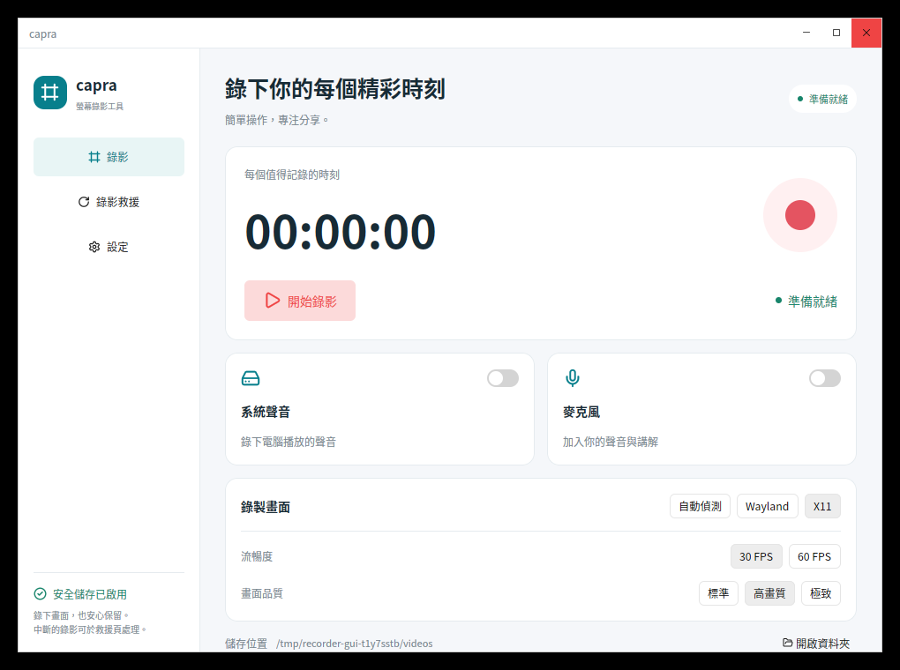

# capra

Ubuntu/Linux 的 Rust 桌面錄影工具，使用 **GPUI Component / GPUI Kit 0.8.1** 介面。支援 Wayland（Desktop Portal / PipeWire）及 X11、系統聲音與麥克風混音。

介面分為「錄影、錄影救援、設定」三個頁面，以左側導覽切換。主頁提供錄影計時、音訊開關與畫質選項，設定頁會自動記住調整。



[設定畫面](docs/ui/settings.png) · [救援畫面](docs/ui/recovery.png)

## 錄影與安全儲存

1. 按「開始錄影」，Wayland 使用者依系統視窗選擇畫面。
2. 錄影先寫入 MKV，停止後完成收尾，再無損轉封裝成 MP4。
3. 按停止後會顯示儲存／轉換狀態；此時不能開始另一段錄影。
4. 關閉視窗會先停止、完成寫檔與轉換，再退出。轉換失敗時視窗保留錯誤訊息，MKV 也會留下。

設定頁的「保留 MKV 原檔」預設開啟。取消勾選後，只有在 MP4 成功產生、確認包含有效影音資料並完成檔案同步後，才會刪除 MKV。轉換失敗時一律保留來源。自動播放與開啟資料夾維持獨立選項。

設定會自動儲存到 `$XDG_CONFIG_HOME/capra/settings.json`，沒有指定 XDG_CONFIG_HOME 時使用 `~/.config/capra/settings.json`。

## 當機後救援 / MKV 轉 MP4

重新啟動時，程式會掃描設定的儲存目錄，列出沒有對應 MP4 的 `recording_*.mkv`。在「錄影救援」頁可按「救援轉換」，也能手動選擇、輸入路徑或拖入 MKV。

- 轉換不重新壓縮影音，不覆蓋既有 MP4；同名時另存 `_converted_N.mp4`。
- 目前支援一個視訊軌道及音訊軌道。含額外影像、字幕或附件的 MKV 會明確拒絕，避免遺失未轉出的內容。
- 斷電可能讓最後一小段資料尚未落盤，甚至損壞檔案系統；MKV 無法保證每次完整恢復。
- 正常錄影預留短 cluster，降低對檔尾索引的依賴。轉換使用暫存檔，確認成功後才發布正式 MP4。
- 空間不足會提前停止錄影。若不足以轉 MP4，先清出空間，再於救援頁重試。
- 保留 MKV 時需要同時存放 MKV 與 MP4，約需兩份影音資料的空間。

## 相依環境與執行

需要 **Rust 1.95.0 或更新版本**、可用的 Vulkan 圖形驅動、GStreamer 開發套件及對應的影像來源／H.264／AAC／Matroska 插件、FFmpeg（含 ffprobe）、PulseAudio 或 PipeWire 的 PulseAudio 相容層及 `pactl`。Wayland 另需可用的 xdg-desktop-portal 與桌面後端；檔案選擇器使用系統 Portal。中文字型使用系統的 Noto CJK 等字型。Linux 客戶端裝飾的標題列會透過安全關閉流程等待錄影完成。

```bash
# 使用 rustup 時會依 rust-toolchain.toml 選擇 Rust 1.95.0
cargo run
cargo build --release
./target/release/capra

# 這台電腦另有專案專用工具鏈，不變更系統 Rust
./tools/cargo.sh run
./tools/cargo.sh build --release
```

可於設定頁加入 Ubuntu 應用程式選單。啟動器會指向安裝時正在執行的二進位檔；請使用更新後的執行檔重新加入。F9 可開始／停止，跨視窗快捷鍵需先在設定頁註冊 GNOME 系統快捷鍵。

## 驗證

```bash
# 核心測試不需要載入 GPU 介面，可在無螢幕環境執行
./tools/cargo.sh test --no-default-features --lib
./tools/cargo.sh fmt --check
./tools/cargo.sh clippy --all-targets -- -D warnings
./tools/cargo.sh build
# 需要 Xvfb、libXtst 與 FFmpeg；會拒絕干擾正在執行的錄影程式
python3 tests/gui_close_smoke.py target/debug/capra
```

測試涵蓋正常 GStreamer 影音錄影、EOS 逾時、SIGKILL 中斷後的 MKV 救援、保留／刪除設定、損壞輸入、同名輸出、額外軌道保護、完成訊息競態與設定持久化。GUI 測試使用獨立 Xvfb 畫面，不錄製使用者桌面，檢查停止後立即關閉及錄影中直接關閉的實際流程。


## 開發結構

- `src/controller.rs`：錄影工作、訊息、設定與關閉協調，獨立於 UI 框架。
- `src/ui.rs`：GPUI Component 介面、輸入、開關、滑桿與頁面。
- `src/main.rs`：GPUI 啟動、單一實例 IPC 與原生視窗生命週期。
- `src/recording.rs`、`src/media.rs`：GStreamer 錄影與 FFmpeg 轉檔／救援。

GPUI Kit 版本已固定，避免相依的 GPUI 快照不相容。其 GPUI 快照使用 Rust 1.95 的 `std::hint::cold_path`，因此系統 Rust 1.93 不足以編譯新版 UI。工具鏈安裝在使用者快取，不修改系統預設版本。其他開發環境可直接使用 rustup 的 1.95.0 工具鏈。

參考：[GPUI Kit](https://github.com/longbridge/gpui-kit)、[Rust cold_path](https://doc.rust-lang.org/std/hint/fn.cold_path.html)。
